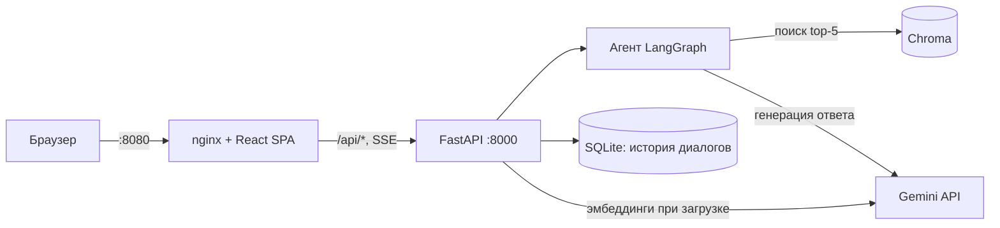

# Чат-бот по корпоративным регламентам

RAG-бот: загружаете регламенты компании (PDF, DOCX, MD, TXT), задаёте вопросы в чате и получаете ответ со ссылками на источники (файл, страница или раздел). Ответы стримятся в браузер по мере генерации.

Стек: FastAPI + LangChain/LangGraph + Chroma + Gemini (бэкенд), React + Vite (фронтенд), nginx и Docker Compose.

## Архитектура



Наружу опубликован только порт `8080` (frontend). Бэкенд слушает `8000` только внутри сети compose, все запросы к `/api/` идут через nginx.

## Быстрый старт

1. Получите ключ Gemini API в [Google AI Studio](https://aistudio.google.com/apikey).
2. Создайте `.env` из шаблона и впишите ключ:

   ```bash
   cp .env.example .env
   # откройте .env и задайте GOOGLE_API_KEY=...
   ```

3. Запустите:

   ```bash
   docker compose up --build
   ```

4. Откройте http://localhost:8080.

Без `GOOGLE_API_KEY` приложение стартует, `/health` отвечает 200, а все запросы к `/api/*` возвращают 503 с текстом "Не задан GOOGLE_API_KEY".

Данные (векторная база, загруженные файлы, история диалогов) лежат в docker volume `rag-data` и переживают перезапуск.

## Gemini API и российские IP

Gemini API недоступен с российских IP-адресов. Если вы запускаете бота из России, нужен прокси или VPN, через который идут запросы к Gemini. Укажите адрес прокси в `.env`:

```bash
HTTPS_PROXY=http://host:port
```

или передайте его при запуске:

```bash
HTTPS_PROXY=http://host:port docker compose up --build
```

Переменные `HTTPS_PROXY` и `NO_PROXY` пробрасываются в контейнер бэкенда. По умолчанию `NO_PROXY=backend,localhost,127.0.0.1`, чтобы внутренний трафик не уходил в прокси. Если прокси работает на вашей машине, из контейнера он доступен по адресу `host.docker.internal`, например `http://host.docker.internal:7890`.

## Поддерживаемые форматы и источники

Формат определяется по расширению (без учёта регистра). Старый `.doc` не поддерживается. Максимальный размер файла - 20 МБ.

| Формат | Метка источника в ответе | Пример |
|--------|--------------------------|--------|
| PDF | файл и страница (нумерация с 1) | `[otpuska.pdf, стр. 3]` |
| DOCX, MD с заголовками | файл и раздел | `[komandirovki.docx, раздел "3. Суточные"]` |
| TXT, DOCX/MD без заголовков | только файл | `[faq.txt]` |

PDF-сканы без текстового слоя не обрабатываются: бот сообщит, что не удалось извлечь текст.

## Как устроен поиск

Поиск гибридный: BM25 с русской морфологией (стемминг Snowball, номера пунктов и суммы вроде `3.2`, `1500`, `1,5` остаются целыми токенами) плюс векторный поиск по эмбеддингам. Результаты двух веток объединяются через Reciprocal Rank Fusion (`EnsembleRetriever`). BM25 хорошо находит точные термины и коды, векторный поиск - близкие по смыслу формулировки. Индекс BM25 строится из Chroma при старте и перестраивается после каждой загрузки и удаления документа. Настройки: `RETRIEVAL_CANDIDATES` (сколько кандидатов берёт каждая ветка, по умолчанию 10) и `BM25_WEIGHT` (вес BM25 при слиянии, по умолчанию 0.5).

## Демо-документы и примеры вопросов

В папке `sample_docs/` лежат пять демонстрационных файлов вымышленной компании: два PDF, DOCX, MD и TXT. Загрузите их через интерфейс (кнопка загрузки документов) и задавайте вопросы.

Список вопросов с ожидаемыми ответами и источниками находится в [`sample_docs/FACTS.md`](sample_docs/FACTS.md). Например:

- Сколько календарных дней составляет ежегодный основной отпуск?
- Какой минимальной длины должен быть пароль?
- Каков размер суточных в командировке в Казань?

## Смена модели эмбеддингов

Если изменить `EMBEDDING_MODEL`, ранее проиндексированные документы станут несовместимы с новой моделью. Нужна переиндексация: удалите документы в интерфейсе и загрузите заново либо удалите volume целиком (это сотрёт и историю диалогов):

```bash
docker compose down
docker volume rm documentation-rag_rag-data
```

Имя volume начинается с имени папки проекта, точное имя смотрите в `docker volume ls`.

## Локальная разработка

Бэкенд (Python 3.12):

```bash
cd backend
python3.12 -m venv .venv
.venv/bin/pip install -r requirements-dev.txt
cp ../.env.example .env   # задайте GOOGLE_API_KEY (бэкенд читает .env из своей рабочей папки)
.venv/bin/uvicorn app.main:app --reload --port 8000
```

Фронтенд (Node 22), dev-сервер проксирует `/api` на `http://localhost:8000`:

```bash
cd frontend
npm ci
npm run dev
```

Откройте адрес, который напечатает Vite (по умолчанию http://localhost:5173).

## Тесты

Тесты не обращаются к реальному Gemini API, используются фейковые модели.

```bash
cd backend && .venv/bin/pytest -q
cd frontend && npm test
```
